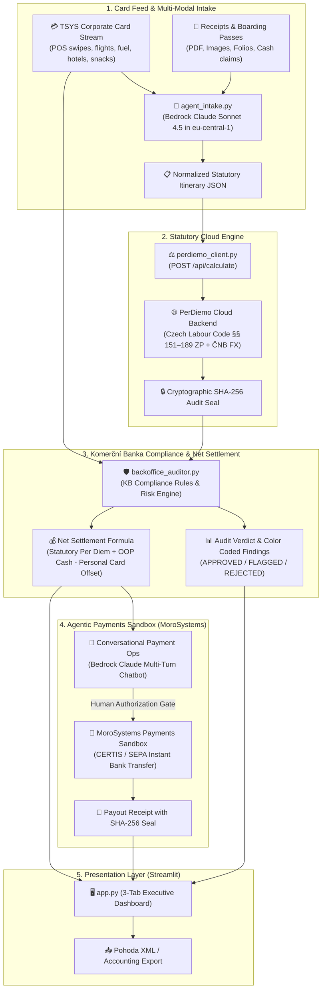

# PerDiemo Copilot — Developer & AI Agent Specification (v1.1.2)

> **Document Version:** 1.1.2  
> **Release Target:** The FinTechers Hackathon 2026 (Prague)  
> **Tracks:**  
> • 🎯 **Track 01:** Agentic Payments & Money Movement (*Challenge: The Self-Reconciling Merchant / Conversational Payment Ops*)  
> • 🛡️ **Track 06:** Finance Operations & Back-Office AI (*Partner Challenge: Automating Back-Office Document Controls — Komerční banka*)  
> **Target Audience:** Core Developers, AI Coding Assistants (Antigravity, Cursor, Kiro, Claude Code, Roo Code), Hackathon Auditors

---

## 1. System Mission & Core Directives

PerDiemo Copilot is an autonomous agentic system designed to eliminate corporate travel expense fraud, automate statutory per diem calculations, reconcile corporate card transactions, and provide evidentiary audit defence for **Komerční banka** and enterprise accounting departments.

### Primary Directives for Developers and AI Agents:
1. **Statutory Compliance Above All:** Calculations must adhere strictly to the Czech Labour Code (*Zákon č. 262/2006 Sb., §§ 151–189*), mandatory meal deduction brackets (70% / 35% / 25%), and daily ČNB currency fixing rates.
2. **Evidentiary Standard (NSS 3 Afs 97/2025 - 71):** In tax audits, the employer bears the burden of proof (*důkazní břemeno*). Every calculation must be sealed with a SHA-256 cryptographic verification signature.
3. **AWS European Guardrails:** All Bedrock inferences and cloud infrastructure must run in Frankfurt (`eu-central-1`) using EU cross-region inference profiles (prefixed with `eu.`). Never attempt bare `anthropic.` model IDs or US regions.
4. **Deterministic Auditing:** LLM extraction is isolated to document intake and JSON normalization. Statutory calculations and compliance rule enforcement are executed deterministically by code and the PerDiemo cloud engine.
5. **Human-in-the-Loop Safe Agentic Payments:** Write actions transferring money via the MoroSystems Payments Sandbox require explicit human confirmation.

---

## 2. System Architecture & Component Interaction



---

## 3. Key Architectural Decisions (ADRs v1.1.2)

### ADR-01: Bedrock Cross-Region EU Inference Profile
* **Decision:** Bedrock Claude model ID is set to `eu.anthropic.claude-sonnet-4-5-20250929-v1:0`.
* **Rationale:** AWS European regions mandate the `eu.` prefix for Claude models. Standard `anthropic.` IDs produce `ValidationException: Missing EU prefix`.
* **Cost Efficiency:** Sonnet 4.5 is utilized for precision multimodal extraction and multi-turn chat; for batch evaluation, `eu.anthropic.claude-haiku-4-5-20251001-v1:0` is supported via `BEDROCK_MODEL_ID` in `.env`.

### ADR-02: Zero Long-Lived Access Keys & SSO Session Split
* **Decision:** Authentication utilizes AWS IAM Identity Center SSO session `hackathon` mapped to profile `martin-hackathon`.
* **Rationale:** Account guardrails block long-lived IAM access keys. SSO sign-in directory lives in Stockholm (`eu-north-1`), while the team workload runs in Frankfurt (`eu-central-1`).

### ADR-03: Two-Tier LLM + Deterministic Engine Pipeline
* **Decision:** The LLM does NOT calculate per diems, tax brackets, or currency exchange math.
* **Rationale:** LLMs hallucinate complex Czech legislative nuances (§ 163 and § 170 ZP) and floating-point exchange rate math. Claude Sonnet 4.5 parses unstructured documents into structured JSON; the PerDiemo statutory engine performs the mathematical and legal calculation.

### ADR-04: Resilient Self-Contained Testing & Offline Fallbacks
* **Decision:** `test_aws.py` and `agent_intake.py` contain zero-dependency fallback parsers and mock generators.
* **Rationale:** Allows continuous offline development, live demo resilience, and rapid testing even if AWS SSO tokens expire or network connections drop.

### ADR-05: Human-in-the-Loop Execution Gate for Autonomous Payments
* **Decision:** Although the agent autonomously clusters transactions, detects statutory allowances, and computes the exact net reimbursement, it cannot unilaterally dispatch money without human confirmation.
* **Rationale:** Track 01 financial guardrails require explicit human approval before executing irreversible write actions against the MoroSystems payments sandbox.

### ADR-06: Strict Non-Inference from Raw Card Feeds (Hotel Breakfast Rule)
* **Decision:** Raw card transaction feeds from bank networks (TSYS) contain POS descriptors (e.g. `HOTEL ADLON KEMPINSKI BERLIN`) without itemized folios. The agent must NEVER infer complimentary breakfast or meal deductions from raw card spend alone; hotel stays default to room-only (0% deduction) unless an itemized invoice is provided in Tab 2.
* **Rationale:** Assuming breakfast without folio evidence violates § 163 ZP and arbitrarily reduces an employee's statutory allowance.

### ADR-07: Conversational Multi-Turn Context & Dynamic Feed Generation
* **Decision:** The Copilot chat interface (`app.py`) maintains a persistent multi-turn thread history with Bedrock Claude Sonnet 4.5, augmented with trip settlement metadata, statutory citations, and card feed context. A dynamic generation button produces randomized real-world European card feeds on demand (flights, trains, buses, personal car fuel, grocery snacks, hotels).
* **Rationale:** Empowers back-office accountants and corporate travelers to interrogate specific rules, explain deductions, and audit decisions conversationally.

---

## 4. Data Contracts & Schemas

### 4.1 Normalized Statutory Itinerary JSON Schema (`agent_intake.py` ➔ `perdiemo_client.py`)
```json
{
  "ucel_cesty": "Client Negotiations & Technology Demonstration",
  "typ_vozidla": "SLUZEBNI",
  "zamestnanec_jednatel": "Alex Miller",
  "spolecnost": "Komerční banka Corporate Client a.s.",
  "itinerary": [
    {
      "typ": "ODJEZD",
      "datum": "2025-06-10T07:00",
      "misto": "Prague",
      "vzdalenost_km": 0.0,
      "transport_type": "company_car",
      "country_code": "CZE",
      "layover_type": null
    },
    {
      "typ": "HRANICE_PRECHOD",
      "datum": "2025-06-10T09:30",
      "misto": "Mikulov",
      "vzdalenost_km": 200.0,
      "transport_type": "company_car",
      "country_code": "CZE",
      "layover_type": null
    },
    {
      "typ": "PRIJEZD",
      "datum": "2025-06-10T11:00",
      "misto": "Vienna",
      "vzdalenost_km": 80.0,
      "transport_type": "company_car",
      "country_code": "AUT",
      "layover_type": "meeting"
    }
  ],
  "bezplatna_strava": {
    "2025-06-11": ["snidane"]
  },
  "hotel_info": {
    "hotel_name": "Grand Hotel Wien",
    "breakfast_included": false
  }
}
```

### 4.2 Corporate Card Transaction Schema (`sample_data/tsys_card_feed.json`)
```json
{
  "transaction_id": "TX-TSYS-992144",
  "timestamp": "2025-06-10T08:15:00",
  "card_last4": "4821",
  "merchant_name": "ÖBB Ticket Automat",
  "merchant_city": "Vienna",
  "merchant_country": "AUT",
  "mcc": "4112",
  "amount": 42.50,
  "currency": "EUR",
  "billing_amount_czk": 1067.60,
  "expense_type": "TRAVEL_TRANSPORT",
  "is_business_expense": true
}
```

### 4.3 Net Settlement & Offset Schema (`backoffice_auditor.py`)
```json
{
  "statutory_per_diem_czk": 2062.94,
  "meal_deductions_czk": 0.00,
  "out_of_pocket_czk": 628.00,
  "personal_card_offset_czk": 372.96,
  "company_paid_card_czk": 5420.50,
  "net_reimbursement_czk": 2317.98,
  "currency": "CZK",
  "ready_for_payout": true,
  "requires_human_approval": true,
  "verification_signature": "a4fe0633a5153d3a4ef58897..."
}
```

### 4.4 MoroSystems Payout Order Schema (`morosystems_client.py`)
```json
{
  "payment_id": "PAY-MORO-20250612-8841",
  "recipient_name": "Alex Miller",
  "recipient_iban": "CZ6501000000001928374650",
  "amount": 2317.98,
  "currency": "CZK",
  "clearing_system": "CERTIS_INSTANT",
  "settled_at": "2025-06-12T17:45:00Z",
  "transfer_verification_hash": "c894fb21a941e7..."
}
```

---

## 5. Compliance & Audit Rules Matrix (`backoffice_auditor.py`)

### 5.1 Core Compliance & Fraud Rules
| Rule ID | Severity | Risk Weight | Statutory Reference | Logic Description |
|---|---|---|---|---|
| `KB-RULE-01-MEAL-DOUBLE-DIPPING` | `CRITICAL` / `PASSED` | +45 | §§ 163 & 170 ZP | Verifies whether complimentary hotel breakfast is deducted from per diems. If hotel folio includes breakfast but `bezplatna_strava` does not declare `snidane`, triggers CRITICAL audit alert. |
| `KB-RULE-02-WEEKEND-TRAVEL-ANOMALY` | `WARNING` / `PASSED` | +25 | § 156 ZP | Detects trip legs occurring on Saturday or Sunday. Requires explicit business justification keywords (e.g. `conference`, `urgent`, `veletrh`, `audit`) in `ucel_cesty`. |
| `KB-RULE-03-AUDIT-FINGERPRINT` | `CRITICAL` / `PASSED` | +50 | NSS 3 Afs 97/2025 | Verifies presence and integrity of a 64-character SHA-256 cryptographic seal generated by the statutory calculation engine. |
| `KB-RULE-04-CARD-RECONCILIATION` | `INFO` | +0 | KB Open Banking | Cross-references declared travel dates with actual corporate credit card swipe timestamps from bank feeds. |

### 5.2 Financial Settlement & Balancing Rules
| Rule ID | Operation | Balance Impact | Description |
|---|---|---|---|
| `SETTLE-RULE-01-PERSONAL-CARD-OFFSET` | Deduction | `- Amount CZK` | Corporate card charges flagged as `PERSONAL_EXPENSE` (e.g., private snacks, personal items) are deducted from the employee's payout. |
| `SETTLE-RULE-02-OUT-OF-POCKET-REIMBURSEMENT` | Addition | `+ Amount CZK` | Business expenses paid by the employee in cash or personal card (e.g., local taxi) are added to the payout. |
| `SETTLE-RULE-03-COMPANY-CARD-EXCLUSION` | Neutral | `0 CZK` | Legitimate business expenses paid directly with the corporate credit card (hotel, flights, fuel) are covered by the firm and excluded from employee payout. |

### 5.3 Net Reimbursement Formula:
$$\text{Net Payout} = \max\Big(0,\; \text{Statutory Per Diem} + \text{Out-of-Pocket Cash} - \text{Personal Card Offsets}\Big)$$

### 5.4 Audit Verdict Thresholds:
* $\text{Risk Score} \ge 70 \implies$ **`REJECTED`** (High fraud probability or missing legal seal)
* $40 \le \text{Risk Score} < 70 \implies$ **`FLAGGED_FOR_REVIEW`** (Requires accountant approval)
* $\text{Risk Score} < 40 \implies$ **`APPROVED`** (Ready for automated MoroSystems instant payout)

---

## 6. Development Workflow & Daily Operations

### 6.1 Daily AWS SSO Login:
```powershell
.\aws_login.ps1
```

### 6.2 Full Verification Suite:
```powershell
uv run python test_aws.py
```

### 6.3 Launch Interactive Copilot UI:
```powershell
uv run streamlit run app.py
```
Open browser at `http://localhost:8501`.

---

## 7. Guidelines for AI Coding Assistants Operating in this Repo

When automated AI agents (Antigravity, Cursor, Kiro, Roo Code) modify code in this repository, they must adhere to the following rules:

1. **Preserve Fallbacks:** Always maintain offline / mock fallbacks in `agent_intake.py` so the UI and testing suite run even if AWS SSO tokens expire.
2. **Preserve Encoding:** All Python files must use `# -*- coding: utf-8 -*-` and configure stdout/stderr for UTF-8 compatibility on Windows systems.
3. **No Direct Tax Calculations in Prompts:** Ensure travel itineraries extracted from receipts are passed into `perdiemo_client.py` and audited through `backoffice_auditor.py`.
4. **Audit Immutability:** Never bypass the SHA-256 audit seal calculation in `perdiemo_client.py`.
5. **Color-Coded Findings:** When modifying Streamlit audit findings, always use `render_audit_finding(finding)` to maintain consistent status pills and color-coded borders.
6. **Token Economy:** Use structured JSON outputs and targeted prompts to stay within the hackathon Bedrock budget allocation.
