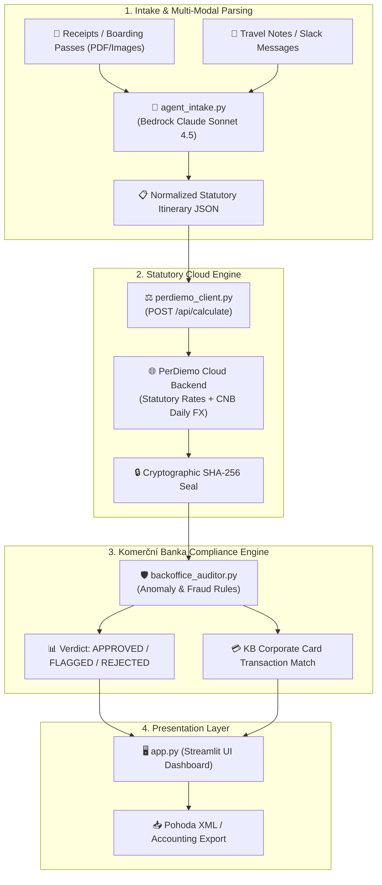

# PerDiemo Copilot — Developer & AI Agent Specification (v1.1.0)

> **Document Version:** 1.1.0  
> **Release Target:** The FinTechers Hackathon 2026 (Prague) — Track 06: Finance Operations & Back-Office AI  
> **Target Audience:** Core Developers, External Contributors, Autonomous AI Coding Agents

---

## 1. System Mission & Core Directives

PerDiemo Copilot is an autonomous agentic system designed to eliminate corporate travel expense fraud, automate statutory per diem calculations, and provide evidentiary audit defence for **Komerční banka** and enterprise accounting departments.

### Primary Directives for Developers and AI Agents:
1. **Statutory Compliance Above All:** Calculations must adhere strictly to the Czech Labour Code (*Zákon č. 262/2006 Sb., §§ 151–189*), mandatory meal deduction brackets (70% / 35% / 25%), and daily ČNB currency fixing rates.
2. **Evidentiary Standard (NSS 3 Afs 97/2025 - 71):** In tax audits, the employer bears the burden of proof. Every calculation must be sealed with a SHA-256 cryptographic verification signature.
3. **AWS European Guardrails:** All Bedrock inferences and cloud infrastructure must run in Frankfurt (`eu-central-1`) using EU cross-region inference profiles (prefixed with `eu.`). Never attempt bare `anthropic.` model IDs or US regions.
4. **Deterministic Auditing:** LLM extraction is isolated to document intake and JSON normalization. Statutory calculations and compliance rule enforcement are executed deterministically by code and the PerDiemo cloud engine.

---

## 2. System Architecture & Component Interaction



---

## 3. Key Architectural Decisions (ADRs)

### ADR-01: Bedrock Cross-Region EU Inference Profile
* **Decision:** Bedrock Claude model ID is set to `eu.anthropic.claude-sonnet-4-5-20250929-v1:0`.
* **Rationale:** AWS European regions mandate the `eu.` prefix for Claude models. Standard `anthropic.` IDs produce `ValidationException: Missing EU prefix`.
* **Cost Efficiency:** Sonnet 4.5 is utilized for precision multimodal extraction; for batch evaluation, `eu.anthropic.claude-haiku-4-5-20251001-v1:0` is supported via `BEDROCK_MODEL_ID` in `.env`.

### ADR-02: Zero Access Keys & SSO Session Split
* **Decision:** Authentication utilizes AWS IAM Identity Center SSO session `hackathon` mapped to profile `martin-hackathon`.
* **Rationale:** Account guardrails block long-lived IAM access keys. SSO sign-in directory lives in Stockholm (`eu-north-1`), while the team workload runs in Frankfurt (`eu-central-1`).

### ADR-03: Two-Tier LLM + Deterministic Engine Pipeline
* **Decision:** The LLM does NOT calculate per diems, tax brackets, or currency exchange math.
* **Rationale:** LLMs hallucinate complex Czech legislative nuances (§ 163 and § 170 ZP) and floating-point exchange rate math. Claude Sonnet 4.5 parses unstructured documents into structured JSON; the PerDiemo statutory engine performs the mathematical and legal calculation.

### ADR-04: Resilient Self-Contained Testing & Fallbacks
* **Decision:** `test_aws.py` and `agent_intake.py` contain zero-dependency fallback parsers and mock generators.
* **Rationale:** Allows offline development and fast local testing even before AWS credentials or external packages are fully resolved.

---

## 4. Data Contracts & Itinerary Schema

AI agents and back-office parsers must strictly emit and accept the following JSON schema:

```json
{
  "ucel_cesty": "Client Negotiations & Technology Demonstration",
  "typ_vozidla": "SLUZEBNI",
  "zamestnanec_jednatel": "Alex Miller",
  "spolecnost": "Komerční banka Corporate Client a.s.",
  "itinerary": [
    {
      "typ": "ODJEZD",
      "datum": "2025-06-10T07:00",
      "misto": "Prague",
      "vzdalenost_km": 0.0,
      "transport_type": "company_car",
      "country_code": "CZE",
      "layover_type": null
    },
    {
      "typ": "HRANICE_PRECHOD",
      "datum": "2025-06-10T09:30",
      "misto": "Mikulov",
      "vzdalenost_km": 200.0,
      "transport_type": "company_car",
      "country_code": "CZE",
      "layover_type": null
    },
    {
      "typ": "PRIJEZD",
      "datum": "2025-06-10T11:00",
      "misto": "Vienna",
      "vzdalenost_km": 80.0,
      "transport_type": "company_car",
      "country_code": "AUT",
      "layover_type": "meeting"
    }
  ],
  "bezplatna_strava": {
    "2025-06-11": ["snidane"]
  },
  "hotel_info": {
    "hotel_name": "Grand Hotel Wien",
    "breakfast_included": true
  }
}
```

---

## 5. Compliance & Audit Rules (`backoffice_auditor.py`)

| Rule ID | Severity | Logic & Labour Code Reference |
|---|---|---|
| `KB-RULE-01-MEAL-DOUBLE-DIPPING` | `CRITICAL` (+45 risk) | Triggered when `hotel_info.breakfast_included == True` but `bezplatna_strava` does NOT declare `snidane`. Violates §§ 163 & 170 ZP. |
| `KB-RULE-02-WEEKEND-TRAVEL-ANOMALY` | `WARNING` (+25 risk) | Triggered when trip legs occur on Saturday or Sunday without high-priority business justification in `ucel_cesty`. |
| `KB-RULE-03-AUDIT-FINGERPRINT` | `CRITICAL` (+50 risk) | Triggered if calculation result lacks a valid 64-character SHA-256 seal. Required under NSS 3 Afs 97/2025 - 71. |
| `KB-RULE-04-CARD-RECONCILIATION` | `INFO` | Cross-references declared dates with simulated KB Open Banking corporate card transactions. |

### Verdict Thresholds:
* `risk_score >= 70` $\rightarrow$ **`REJECTED`**
* `risk_score >= 40` $\rightarrow$ **`FLAGGED_FOR_REVIEW`**
* `risk_score < 40` $\rightarrow$ **`APPROVED`**

---

## 6. Development Workflow & Daily Operations

### Daily AWS SSO Login:
```powershell
.\aws_login.ps1
```

### Full Verification Suite:
```powershell
uv run python test_aws.py
```

### Launch Interactive Copilot UI:
```powershell
uv run streamlit run app.py
```
