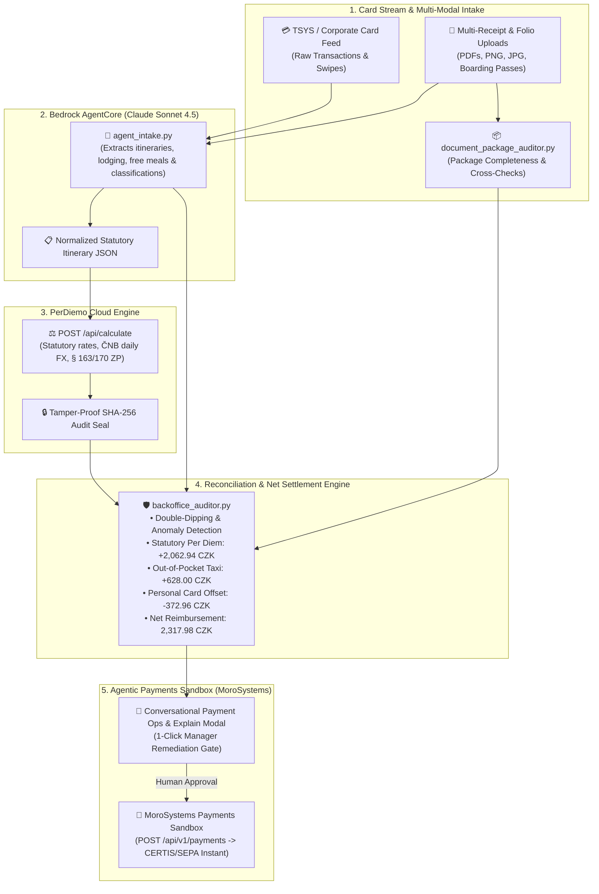

# PerDiemo Copilot — Self-Reconciling Travel Card & Autonomous Payout Agent

> **The FinTechers Hackathon 2026 (Prague)**  
> 🎯 **Track 01:** Agentic Payments & Money Movement (*Challenge: The Self-Reconciling Merchant / Conversational Payment Ops*)  
> 🛡️ **Track 06:** Finance Operations & Back-Office AI (*Partner Challenge: Automating Back-Office Document Controls — Komerční banka*)

[](AGENTS.md)
[](https://perdiemo-backend-production.onrender.com)
[](https://aws.amazon.com/bedrock/)
[](https://tsys-api.morosystems.cloud)
[](https://www.perdiemo.eu/cz/legislativa)
[](app.py)

---

## 🎯 Executive Summary & Problem Statement

Corporate travel expense reporting (*vyúčtování pracovních cest*) is notoriously broken for both commercial banks (like **Komerční banka**) and enterprise CFOs:
1. **Administrative Friction:** Employees dread collecting receipts and filling out complex expense forms. Back-office accountants spend weeks manually checking hotel folios, cross-referencing card statements, and enforcing Czech Labour Code (§§ 151–189 ZP) meal deductions.
2. **Audit Exposure (NSS 3 Afs 97/2025 - 71):** In tax audits, the burden of proof is on the employer to prove trip facticity and exact statutory calculations. Without cryptographic evidence, companies face heavy penalties.
3. **Delayed Reimbursement:** Employees wait weeks for payroll to process out-of-pocket cash expenses and statutory per diems.

### The Solution: PerDiemo Copilot (v1.4.0)
An autonomous agentic loop connecting **corporate credit cards (TSYS Sandbox)** and **multi-modal travel documents** to the **PerDiemo Statutory Engine** and **MoroSystems Payments Sandbox**:
- **Proactive Card Ingestion & Clustering:** Agent monitors corporate card streams, identifies foreign travel charges (ÖBB, Grand Hotel Wien, Uber, Shell), and clusters them into trips.
- **Multi-Modal Document Intake & OCR:** Ingests boarding passes, hotel folios, and meal receipts via Bedrock Claude Sonnet 4.5 vision and pure-Python PDF extraction (`pypdf`), classifying document types and verifying package completeness.
- **Automated Fraud & Anomaly Detection:** Detects meal double-dipping fraud under §§ 163 & 170 ZP (e.g. hotel with breakfast + separate breakfast receipt) and weekend travel anomalies under § 156 ZP.
- **2-Way Invoice vs. Banking Stream Matching (v1.4.0):** Autonomous cross-checking between verified invoices and bank settlement streams, identifying exact matches, POS tip variances, cash claims, and unsubstantiated card spend.
- **Automated Statutory Calculation:** Computes legally binding Czech per diems (§§ 151–189 ZP), meal reductions (70%/35%/25%), and ČNB currency fixings sealed with a **tamper-proof SHA-256 signature**.
- **Net Reconciliation Engine:** Offsets personal expenses on company cards (e.g. Billa grocery snack), reimburses out-of-pocket cash (taxi), and calculates exact net dues.
- **Safe Agentic Money Movement:** Executes the net reimbursement payout into the employee's IBAN via **MoroSystems Payments API** with human-in-the-loop confirmation.
- **Conversational Payment Ops & 1-Click Remediation:** Instant natural-language explanations citing exact transactions, statutory articles, and one-click accountant remediation buttons.

---

## 🚀 Built During the Hackathon

In strict compliance with **The FinTechers Hackathon Transparency Rules** (judges evaluate only work committed after the `hackathon-start` marker):

### 1. Pre-Existing Foundation (Disclosed Prior to Kickoff)
- **PerDiemo Cloud Backend Engine:** Core cloud calculation microservice for statutory Czech Labour Code (§§ 151–189 ZP) per diems and daily ČNB currency fixings.
- **Kickoff Marker:** Git tag `hackathon-start` (commit `c7da3ab`).

### 2. Built from Scratch During the Hackathon (Evaluated by Jury)
- 🤖 **Multimodal Bedrock OCR & Document Intake (`agent_intake.py`):**
  - AWS Bedrock Claude Sonnet 4.5 vision & extraction pipeline in Frankfurt (`eu-central-1`) using cross-region inference profile `eu.anthropic.claude-sonnet-4-5-20250929-v1:0`.
  - Multi-file drag-and-drop parsing for boarding passes, hotel folios, taxi receipts, and restaurant bills with pure-Python PDF fallback (`pypdf`, zero external binary dependencies).
- 📦 **Document Package Auditor (`document_package_auditor.py`):**
  - Automated package completeness and cross-document reconciliation engine.
  - Multi-document fraud detection for meal double-dipping (`KB-RULE-01-MEAL-DOUBLE-DIPPING` under §§ 163 & 170 ZP) cross-verifying hotel folios against separate breakfast expense receipts.
- 📑 **2-Way Invoice vs Corporate Card Reconciliation Engine (`invoice_matcher.py` & Tab 4, v1.4.0):**
  - Autonomous 2-way cross-check between OCR-extracted receipts/folios and corporate card banking feeds (`sample_data/invoice_matching_transactions.json`).
  - Categorizes transactions into `EXACT_MATCH`, `AMOUNT_DISCREPANCY` (terminal tips), `ORPHAN_INVOICE` (out-of-pocket cash under § 151 ZP), `ORPHAN_CARD_TRANSACTION` (unsubstantiated spend), and `PERSONAL_CHARGE_OFFSET`.
  - Seamlessly wired into Bedrock Claude Sonnet 4.5 `[💡 Explain]` modal dialogs with 1-click manager remediation and instant MoroSystems CERTIS payout.
- 🛡️ **Komerční Banka Compliance & Fraud Engine (`backoffice_auditor.py`):**
  - Deterministic audit rules matrix for Track 06 (weekend travel anomaly `KB-RULE-02` under § 156 ZP, SHA-256 legal audit seal validation `KB-RULE-03` under NSS 3 Afs 97/2025).
  - Corporate card reconciliation (`KB-RULE-04`) matching declared travel with TSYS swipe timestamps.
  - Financial netting algorithm offsetting personal card expenses against statutory per diems and out-of-pocket cash.
- 💳 **MoroSystems Payments Sandbox Integration (`morosystems_client.py`):**
  - Track 01 agentic money movement with human-in-the-loop authorization gate.
  - Automated payout orders via CERTIS / SEPA Instant with cryptographic SHA-256 payout receipt seals.
- 💬 **Conversational Payment Ops & Manager Remediation (`app.py`):**
  - Multi-turn conversational chatbot powered by Bedrock Claude Sonnet 4.5 explaining audits and citing transactions.
  - 1-click interactive remediation modal dialog allowing finance managers to auto-apply statutory deductions or override warnings with audit trail logging.
- 🖥️ **4-Tab Executive Dashboard (`app.py`):**
  - Tab 1: Proactive Card Stream Clustering & MoroSystems Payout (Track 01).
  - Tab 2: Document & Receipt Compliance Audit with Multimodal OCR (Track 06).
  - Tab 3: Komerční Banka Master Compliance Rules Matrix (7 Rules).
  - Tab 4: 2-Way Invoice Matching & Banking Reconciliation (Tracks 01 & 06 Bridge).
  - Pohoda XML export for enterprise ERP accounting sync.
- 🧪 **Comprehensive Test & Demo Suite (`test_document_parser.py`, `tests/test_invoice_matcher.py`, `test_aws.py`, `demo_documents/`):**
  - Fully verifiable self-contained testing suite with 6/6 automated document checks and 3/3 pytest smoke tests.

---

## 🏗️ System Architecture



---

## 👥 Team Work Breakdown Structure (4-Person Setup)

To maximize velocity during the 30-hour sprint, responsibilities are partitioned into 4 distinct, parallel streams:

| Role | Lead | Focus Area & Deliverables | Core Files |
|---|---|---|---|
| **Dev 1: AI Agent & Bedrock Pipeline** | *AI / LLM Lead* | AWS Bedrock integration, Claude 3.5 Sonnet prompt engineering, multimodal extraction from boarding passes and hotel invoices, structured JSON validation. | `agent_intake.py` |
| **Dev 2: Statutory API & Engine Integration** | *Backend Lead* | Integration with PerDiemo REST API, itinerary validation, multi-currency handling, statutory mileage rules, ČNB FX caching. | `perdiemo_client.py` |
| **Dev 3: Back-Office Auditor & Anomaly Engine** | *Logic / Fraud Lead* | Komerční banka expense compliance rules, corporate card transaction reconciliation, meal double-dipping checks, anomaly scoring. | `backoffice_auditor.py` |
| **Dev 4: UI Dashboard & Pitch Demo** | *Frontend Lead* | Interactive Streamlit demo application, drag-and-drop document upload, live agent trace visualization, side-by-side audit view. | `app.py` |

---

## ⚡ Quickstart (Get Running in 3 Minutes)

### 1. Clone & Set Up Environment
```bash
# Clone the repository
git clone https://github.com/dataquo/perdiemo-fintechers-hackathon-2026.git
cd perdiemo-fintechers-hackathon-2026

# Create Python virtual environment
python -m venv .venv

# Activate virtual environment
# Windows (PowerShell):
.\.venv\Scripts\Activate.ps1
# macOS / Linux:
source .venv/bin/activate

# Install dependencies
pip install -r requirements.txt
```

### 2. Configure Environment Variables
Copy the template configuration or edit `.env`:
```ini
AWS_REGION=eu-central-1
AWS_PROFILE=martin-hackathon
BEDROCK_MODEL_ID=eu.anthropic.claude-sonnet-4-5-20250929-v1:0
PERDIEMO_API_URL=https://perdiemo-backend-production.onrender.com
```

### 3. Verify AWS, OCR & Statutory Engine Setup
```bash
# Verify AWS Bedrock & PerDiemo Cloud Engine
uv run python test_aws.py

# Verify Multi-Modal OCR Document Parser & Demo Datasets (6/6 checks)
uv run python test_document_parser.py

# Run Core Smoke Tests
uv run pytest tests
```

### 4. Launch Interactive Demo Dashboard
```bash
uv run streamlit run app.py
```
Open your browser at `http://localhost:8501`.

For architecture details, data contracts, and AI agent prompt specifications, see [AGENTS.md](AGENTS.md).

---

## 🔌 Live PerDiemo Cloud API Reference

The statutory calculation engine is live in the cloud with zero setup needed:

* **Production URL:** `https://perdiemo-backend-production.onrender.com`
* **Swagger Documentation:** [https://perdiemo-backend-production.onrender.com/docs](https://perdiemo-backend-production.onrender.com/docs)
* **Comprehensive Integration Guide:** [PerDiemo API Documentation](https://github.com/dataquo/PerDiemoEU/blob/main/API.md)

### Key Endpoints:
1. `POST /api/calculate` — Calculates statutory per diems, meal deductions, pocket money (*kapesné*), ČNB currency fixing, and cryptographic SHA-256 signatures.
2. `POST /api/parse-itinerary` — Natural language parser converting text logs into structured itineraries.

---

## 🏆 Hackathon Pitch & Partner Alignment

### Komerční Banka (KB & KB SmartSolutions)
- **Problem Solved:** Automates travel expense verification for KB's corporate clients and accounting partners.
- **Open Banking Synergy:** Matches declared travel expenses directly against KB Corporate Card transactions to prevent expense fraud before reimbursement.

### AWS & Bedrock
- **Tooling Used:** Amazon Bedrock (Claude 3.5 Sonnet / Textract) for multimodal invoice and flight ticket parsing.
- **Efficiency:** Low token footprint via structured tool-calling schema, maximizing the team's $880 credit allocation.

### Legal Audit Defense
- Meets the strict burden of proof (*důkazní břemeno*) required by Czech tax authorities and affirmed by Supreme Administrative Court ruling **NSS 3 Afs 97/2025 - 71**.

---

## 📄 License & Attribution
Developed for **The FinTechers Hackathon 2026** by team PerDiemo.  
Powered by the [PerDiemo Statutory Travel Engine](https://www.perdiemo.eu).
