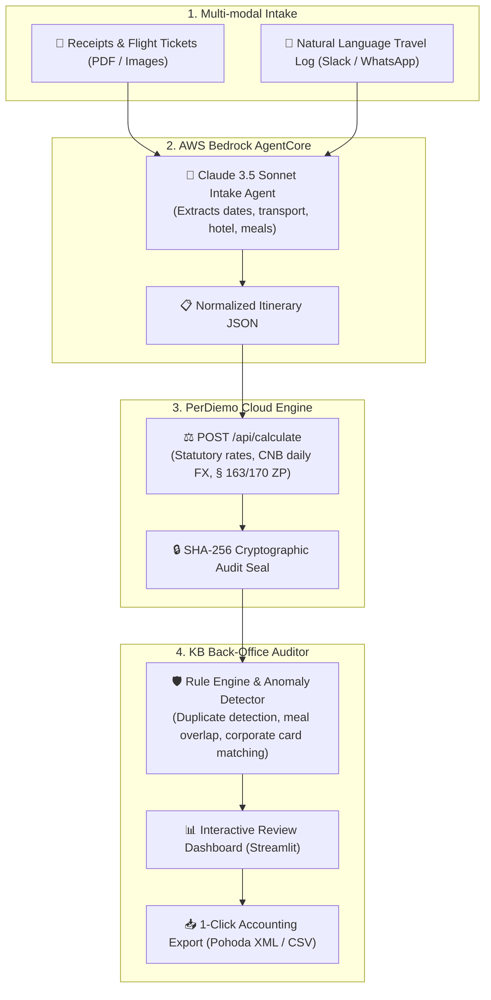

# PerDiemo Copilot — Autonomous Travel Expense & Back-Office Audit Agent

> **The FinTechers Hackathon 2026 (Prague)**  
> **Track 06:** Finance Operations & Back-Office AI  
> **Challenge:** Automating back-office document controls, statutory per diems, and corporate expense reconciliation for **Komerční banka** & enterprise clients.

[](AGENTS.md)
[](https://perdiemo-backend-production.onrender.com)
[](https://aws.amazon.com/bedrock/)
[](https://www.perdiemo.eu/cz/legislativa)
[](app.py)

---

## 🎯 Executive Summary & Problem Statement

Business travel expense reporting (*cestovní náhrady*) is one of the most error-prone back-office operations for corporate accounting departments and bank business clients:
1. **Complex Legislation:** Czech Labour Code (*Zákon č. 262/2006 Sb., §§ 151–189*) mandates multi-tiered daily per diem rates, strict meal deductions (70%/35%/25% per meal), and decisive daily Czech National Bank (ČNB) foreign exchange fixing.
2. **Back-Office Manual Burden:** Accountants manually review paper receipts, flight tickets, hotel folios, and bank statements to detect meal double-dipping, weekend travel, and duplicate claims.
3. **Audit Risk:** Under Czech Supreme Administrative Court case law (**NSS 3 Afs 97/2025 - 71**), the evidentiary burden rests on the employer to prove trip facticity and exact calculation integrity during tax audits.

### The Solution: PerDiemo Copilot
An autonomous end-to-end agentic workflow that:
- **Ingests** receipts, boarding passes, and natural language trip notes via **AWS Bedrock (Claude 3.5 Sonnet / Textract)**.
- **Normalizes** unstructured travel events into standardized statutory itineraries.
- **Calculates** legally binding travel allowances and ČNB currency fixings via the **PerDiemo REST API** (`https://perdiemo-backend-production.onrender.com`).
- **Audits** expense claims with automated fraud and anomaly detection (Komerční banka corporate card matching, meal double-dipping detection, weekend claims verification).
- **Protects** the company with cryptographic **SHA-256 tamper-proof audit verification signatures**.

---

## 🏗️ System Architecture



---

## 👥 Team Work Breakdown Structure (4-Person Setup)

To maximize velocity during the 30-hour sprint, responsibilities are partitioned into 4 distinct, parallel streams:

| Role | Lead | Focus Area & Deliverables | Core Files |
|---|---|---|---|
| **Dev 1: AI Agent & Bedrock Pipeline** | *AI / LLM Lead* | AWS Bedrock integration, Claude 3.5 Sonnet prompt engineering, multimodal extraction from boarding passes and hotel invoices, structured JSON validation. | `agent_intake.py` |
| **Dev 2: Statutory API & Engine Integration** | *Backend Lead* | Integration with PerDiemo REST API, itinerary validation, multi-currency handling, statutory mileage rules, ČNB FX caching. | `perdiemo_client.py` |
| **Dev 3: Back-Office Auditor & Anomaly Engine** | *Logic / Fraud Lead* | Komerční banka expense compliance rules, corporate card transaction reconciliation, meal double-dipping checks, anomaly scoring. | `backoffice_auditor.py` |
| **Dev 4: UI Dashboard & Pitch Demo** | *Frontend Lead* | Interactive Streamlit demo application, drag-and-drop document upload, live agent trace visualization, side-by-side audit view. | `app.py` |

---

## ⚡ Quickstart (Get Running in 3 Minutes)

### 1. Clone & Set Up Environment
```bash
# Clone the repository
git clone https://github.com/dataquo/perdiemo-fintechers-hackathon-2026.git
cd perdiemo-fintechers-hackathon-2026

# Create Python virtual environment
python -m venv .venv

# Activate virtual environment
# Windows (PowerShell):
.\.venv\Scripts\Activate.ps1
# macOS / Linux:
source .venv/bin/activate

# Install dependencies
pip install -r requirements.txt
```

### 2. Configure Environment Variables
Copy the template configuration or edit `.env`:
```ini
AWS_REGION=eu-central-1
AWS_PROFILE=martin-hackathon
BEDROCK_MODEL_ID=eu.anthropic.claude-sonnet-4-5-20250929-v1:0
PERDIEMO_API_URL=https://perdiemo-backend-production.onrender.com
```

### 3. Verify AWS & Statutory Engine Setup
```bash
uv run python test_aws.py
```

### 4. Launch Interactive Demo Dashboard
```bash
uv run streamlit run app.py
```
Open your browser at `http://localhost:8501`.

For architecture details, data contracts, and AI agent prompt specifications, see [AGENTS.md](AGENTS.md).

---

## 🔌 Live PerDiemo Cloud API Reference

The statutory calculation engine is live in the cloud with zero setup needed:

* **Production URL:** `https://perdiemo-backend-production.onrender.com`
* **Swagger Documentation:** [https://perdiemo-backend-production.onrender.com/docs](https://perdiemo-backend-production.onrender.com/docs)
* **Comprehensive Integration Guide:** [PerDiemo API Documentation](https://github.com/dataquo/PerDiemoEU/blob/main/API.md)

### Key Endpoints:
1. `POST /api/calculate` — Calculates statutory per diems, meal deductions, pocket money (*kapesné*), ČNB currency fixing, and cryptographic SHA-256 signatures.
2. `POST /api/parse-itinerary` — Natural language parser converting text logs into structured itineraries.

---

## 🏆 Hackathon Pitch & Partner Alignment

### Komerční Banka (KB & KB SmartSolutions)
- **Problem Solved:** Automates travel expense verification for KB's corporate clients and accounting partners.
- **Open Banking Synergy:** Matches declared travel expenses directly against KB Corporate Card transactions to prevent expense fraud before reimbursement.

### AWS & Bedrock
- **Tooling Used:** Amazon Bedrock (Claude 3.5 Sonnet / Textract) for multimodal invoice and flight ticket parsing.
- **Efficiency:** Low token footprint via structured tool-calling schema, maximizing the team's $880 credit allocation.

### Legal Audit Defense
- Meets the strict burden of proof (*důkazní břemeno*) required by Czech tax authorities and affirmed by Supreme Administrative Court ruling **NSS 3 Afs 97/2025 - 71**.

---

## 📄 License & Attribution
Developed for **The FinTechers Hackathon 2026** by team PerDiemo.  
Powered by the [PerDiemo Statutory Travel Engine](https://www.perdiemo.eu).
